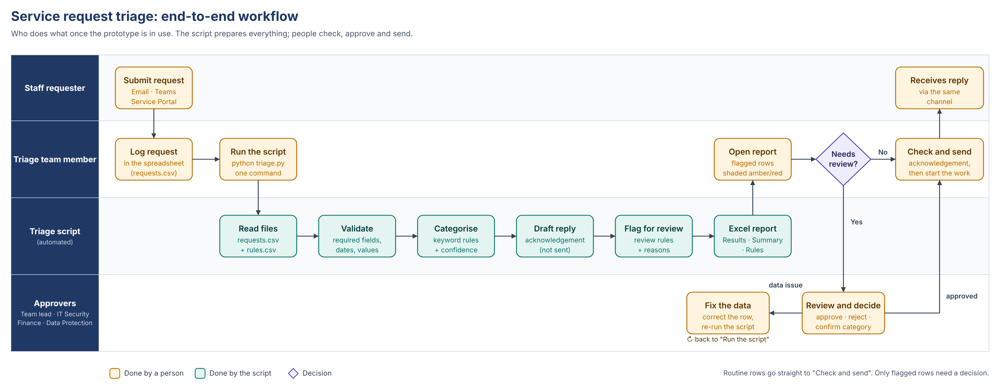
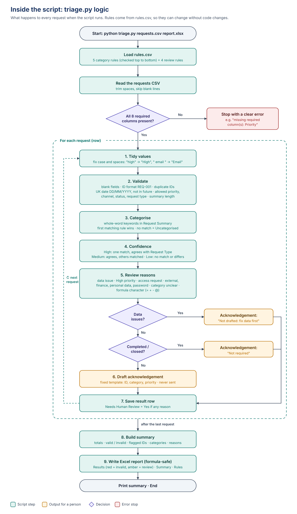

# Service Request Triage – Prototype

A small team receives service requests in a spreadsheet. Today one person reads every
row, picks a category, writes an acknowledgement and decides which requests need
attention. This prototype does that sorting automatically and consistently, and leaves
the decisions that need judgement to a person.

This repository contains:
1. **A working prototype**: a rules-based triage script, synthetic data, 3 tests and Excel outputs.
2. **A proposed production design** ([jump to it](#production-design-proposed--not-built-in-this-prototype)). It shows how the same rules would run on live requests from Outlook, Teams, SharePoint and Dynamics 365 via Microsoft Graph, with a checked AI document reader, an exception queue, observability and CI/CD.

## What it does

For every request in the CSV file, the script:

| Step (from the brief) | What the script does |
|---|---|
| 1. Read the requests | Reads the CSV and checks that all 8 required columns exist |
| 2. Check required information | Flags blank fields, invalid priority, channel, status or request type, invalid or future dates (UK DD/MM/YYYY), badly formatted or duplicate IDs, and summaries that are too short |
| 3. Categorise with simple rules | Matches whole-word keywords in the **Request Summary** against `rules.csv` (first match wins), records the keywords that matched, any other categories that also matched, and a confidence level |
| 4. Suggest an acknowledgement | Fills a fixed template with the ID, category and priority. **It is never sent automatically.** No draft is made for invalid rows or for requests that are already completed |
| 5. Identify requests for human review | Flags each request that needs a person and records **why** (see below) |
| 6. Create an output | Writes an Excel report with **Results**, **Summary** and **Rules** sheets, and prints the summary |

### When a person must review a request

- Any data issue
- High priority
- Access & Permissions requests (access must be approved by a person)
- The summary mentions external or third-party access, finance or payments, personal or sensitive data, or passwords (keyword lists are in `rules.csv`)
- No category rule matched, or the rules disagree with the Request Type the requester chose
- The summary starts with a spreadsheet formula character (`= + - @`)

Requests that are already Completed, Closed or Cancelled are not triaged again.

## Folder contents

```
triage.py                 the prototype
rules.csv                 category and review keywords (editable in Excel)
requirements.txt          openpyxl, pytest
data/requests.csv         the 10 synthetic requests supplied with the task
data/test_requests.csv    12 extra synthetic rows with errors and edge cases
tests/test_triage.py      the three test scenarios
output/triage_output.xlsx result for data/requests.csv
output/test_output.xlsx   result for data/test_requests.csv
evidence/                 test results and console output from each run
docs/                     workflow and production diagrams (PNG), all in workflow_design.pdf
```

## Workflow design





## How to run

Requires Python 3.9 or later.

```bash
pip install -r requirements.txt

python triage.py data/requests.csv output/triage_output.xlsx
python triage.py data/test_requests.csv output/test_output.xlsx

python -m pytest -v
```

On Windows, use `py` instead of `python`.

## Output (Results sheet)

The 8 original columns are kept unchanged, and these are added:

| Column | Meaning |
|---|---|
| Validation Status / Validation Issues | Valid or Invalid, and every problem found |
| Assigned Category | Category from the keyword rules, or Uncategorised |
| Matched Keywords / Also Matched | Why that category was chosen, and any other categories that also matched |
| Category Confidence | High: one clear match that agrees with the Request Type. Medium: agrees, but other categories also matched. Low: no match, or a disagreement |
| Suggested Acknowledgement | The draft reply for a person to check and send |
| Needs Human Review / Review Reasons | Yes or No, and why |

Rows with data issues are shaded red. Rows that need review are shaded amber.

**Result on the supplied data:** all 10 rows are valid and every rule-based category
agrees with the submitted Request Type. 6 requests need review (REQ-001, 002, 004, 006,
007 and 009) and 4 need no manual triage. 9 acknowledgements are drafted; REQ-010 is
skipped because it is already completed.

## Changing the rules

Open `rules.csv` in Excel. Each row is a rule:

- `category` rows: the category name and its keywords, separated by `;`. Rows are checked from top to bottom, and the first match wins.
- `review` rows: the reason a person must review the request, and the keywords that trigger it.

No code changes are needed.

## Tests

| Test | What it proves |
|---|---|
| 1 – Supplied data | All 10 rows are valid and correctly categorised; exactly the expected 6 are flagged, with the right reasons; REQ-001's ambiguity (access and dashboard) is recorded; the completed request gets no acknowledgement; the Excel report has all 3 sheets |
| 2 – Invalid data (7 cases) | Missing summary, priority "Urgent", 31/02/2026, duplicate ID, `REQ104`, a future date, and a role made only of spaces are each caught, flagged, and never acknowledged |
| 3 – Edge cases | No keyword match leads to Uncategorised and review; a rule/type disagreement is flagged and the category is left out of the acknowledgement; mixed case is tidied; 13/10/2026 is read as a UK date; multiple reasons are all recorded; a formula in a summary is stored as plain text; a file with missing columns is rejected with a clear message |

The test results are in `evidence/pytest_results.txt` (9 passed: 3 scenarios, with test 2 run for 7 inputs).
The tests were also checked by deliberately breaking the code (US date format, no formula
protection, removing the High-priority rule); each break was caught by a failing test.

## Design decisions

- **Keyword rules, not an LLM, for the core.** The brief asks for simple rules. Rules are
  predictable, explainable, free, and keep all request text inside the organisation.
- **Suggested, not sent.** A person checks every acknowledgement before it goes out.
- **Doesn't guess.** If no rule matches, or the rules disagree with the requester, a person decides.
- **Rules kept in a separate file**, so the team can maintain them without a developer.

## Limitations

- Keyword rules miss requests that use different wording (for example "can't log on")
  and can be misled by words used in another sense. They need tuning as real requests arrive.
- The prototype has been tested only on small synthetic data.
- The CSV has no requester name or email, so acknowledgements can't be sent automatically yet.
- It runs on demand. There is no scheduling or audit log of who acted on each flag.

## Security considerations

- Synthetic data only; no real personal or university information.
- No network calls. Request text never leaves the machine.
- Spreadsheet formula injection is neutralised in the output file.
- Access, external, finance and personal-data requests always go to a person.
- In production, the input and output files should sit in a restricted SharePoint or
  OneDrive location, and any real request data should be handled under UK GDPR and the
  university's data protection policy.

## Production design (proposed – not built in this prototype)


In production, requests don't arrive as a tidy CSV. They come in as emails, Teams messages,
portal forms, Dynamics cases and attachments. The design below takes requests from those
channels and runs them through the same triage logic.

**Design principle.** The rules engine in this prototype stays the decision layer. AI is used
only where the input is unstructured, to extract the same 8 fields. Every AI output must pass
deterministic checks before anything acts on it, and anything that fails goes to a person
with a written reason.

### 1. Intake and trigger (Microsoft Graph)

| Channel | How it is read | What triggers the pipeline |
|---|---|---|
| Outlook shared service-desk mailbox | Graph `/users/{mailbox}/messages` (plus attachments) | Graph change notification (webhook) |
| Teams support channel | Graph `/teams/{id}/channels/{id}/messages` | Graph change notification |
| Service portal (SharePoint list, or Microsoft Forms saving to a list) | Graph `/sites/{site-id}/lists/{list-id}/items` | Graph change notification on the list |
| Dynamics 365 cases | Dataverse Web API | Dataverse webhook or Power Automate Dataverse trigger |
| Other university systems (e.g. ITSM tool, student record system) | Their REST APIs | Webhook or scheduled poll into the same queue |
| Other mail, e.g. Gmail | Gmail API | `users.watch` with Cloud Pub/Sub push |

How the trigger works:

- **Receive.** An Azure Function receives each notification and verifies it: the validation-token handshake when the subscription is created, and the `clientState` secret on every notification. It then puts a small message (just the resource ID) on an **Azure Service Bus queue**. The queue absorbs bursts and retries failures. Messages that keep failing go to a dead-letter queue instead of being lost.
- **Process once.** A worker fetches the full item from Graph and starts the pipeline. Processing is **idempotent**, keyed on the Graph item ID, so a repeated notification never creates a duplicate request.
- **Never miss one.** Graph subscriptions expire (under 7 days for Outlook messages, 3 days for Teams messages, under 30 days for SharePoint lists). A scheduled job renews them and handles lifecycle notifications. A scheduled **delta query** (for example `/messages/delta`) catches anything a notification missed.
- **Least privilege.** The pipeline uses an Entra ID app registration with application permissions narrowed to what it needs:
  - Exchange Online **RBAC for Applications** limits mail access to the service-desk mailbox only.
  - **`Sites.Selected`** limits SharePoint access to the one site.
  - The app signs in with a certificate or managed identity, and secrets are kept in Azure Key Vault.
- **Reply on the same channel.** Acknowledgements go back through Graph: a reply to the email (`/messages/{id}/reply`), a post in the Teams thread, or an update to the list item or Dynamics case.

### 2. Document reader and model routing

- **Sensitivity router first.** Microsoft Presidio (open source) scans the text and attachments for personal data: names, student or staff IDs, email addresses, phone numbers and health terms.
- **Sensitive requests go to an in-house model.** This is an open-source model from Hugging Face, served with **vLLM** on a GPU the university controls (a VM in the university's Azure tenant, or on-premises). The primary model is **Qwen3-VL-32B**, which reads both message text and scanned or attached forms. **Gemma 3 27B** is the fallback if the primary is unavailable or its output fails the checks. The data never leaves university infrastructure.
- **Non-sensitive requests can use an LLM API.** **Azure OpenAI**, deployed in the university's own Azure tenant in a UK region, is used where a hosted model suits the task better.
- **Structured output.** The model is called with temperature 0 and a strict JSON schema. It returns the same 8 fields as `data/requests.csv`. For every field it also returns **the exact quote from the source** that supports it, and a confidence score.

### 3. Checks: AI output is never trusted on its own

| Check | What it does | If it fails |
|---|---|---|
| Schema check | The JSON parses and matches the Pydantic model (types, allowed values) | Retry once, then try the fallback model, then send to the exception queue |
| Evidence check | Every extracted value must be found in the source text (quote match). This stops invented fields. | The field is marked "not found" and the request goes to the exception queue |
| Validation rules | This prototype (`triage.py` + `rules.csv`): required fields, UK dates, IDs, duplicates, category keywords, review rules | Flagged with reasons, as today |
| Master data join | The requester is looked up in the staff directory via Graph `/users` (role, department). The category must exist in the master list. | Unknown requester or category goes to the exception queue |
| Gap rules | Catches a missing required field, low confidence, the model and the rules disagreeing on category, or a sensitive topic | The gap explainer writes the reason and the request goes to the exception queue |

The result is a **request table** with standard column names and labels: the columns of
`data/requests.csv` plus the triage columns, stored in a SharePoint list or a Dataverse table.
Every request has the same shape, whichever channel it came from.

### 4. Act

- **All checks pass.** The acknowledgement is drafted and the request is routed to the owning team, as a Dynamics case or a task.
  - At first, a person approves every send.
  - Later, routine, high-confidence categories can be auto-acknowledged, but only once the evaluation results show it is safe.
- **Any check fails.** The **gap explainer** writes a plain-English reason, for example: *"Priority not stated in the email; requester not found in the staff directory."* The request goes to the **exception queue**, and a Teams alert goes to the right reviewer: the team lead, IT Security, Finance or Data Protection.
- **Every correction counts.** Each correction a reviewer makes is saved to the **feedback store**.

### 5. Observe and improve (developer / model owner)

| Practice | How |
|---|---|
| Tracing | **LangSmith** traces every run: the input, prompt version, model, output, check results, latency and token cost. For sensitive data, use self-hosted LangSmith (or self-hosted Langfuse) and mask personal data in traces. |
| Audit log | Every decision is recorded: who or what decided, when, why, and which rule, prompt and model version was used. The log is append-only and kept for as long as university policy requires. It can answer "why was this flagged?" for any request. |
| Feedback store | Reviewer corrections from the exception queue become labelled examples |
| Error review | A weekly review of failed checks and corrected labels, to find the root cause: prompt, model, rule or data |
| Golden dataset | A curated, labelled evaluation set of synthetic and approved, anonymised requests, covering every category, channel and edge case (the same idea as `data/test_requests.csv`) |
| Prompt and rule versions | Prompts are versioned (LangSmith prompt hub or MLflow) and `rules.csv` is kept in Git. Every change goes through a pull request. |
| Regression tests and release gate | Every change re-runs the golden dataset. The release is blocked if any key metric gets worse than the current version. |
| Release and rollback | Approved releases are deployed. Any version of the code, prompt, model or rules can be rolled back to the last good one. |

**Example release-gate targets** (to agree with the team):
- Field extraction accuracy of at least 95%.
- Category precision of at least 0.95 and recall of at least 0.90.
- Evidence check pass rate of at least 98%.
- **100% recall on must-review cases** (access, external, finance, personal data). Missing one of these is the worst failure.
- No personal data in logs or traces.

### 6. Deploy and operate (CI/CD)


| Stage | Steps |
|---|---|
| Build and test | Checkout (GitHub or Azure DevOps), then hash-pinned dependencies, code quality (Ruff/Pylint, type checks), security scan (pip-audit, secret scanning), and tests (pytest for the rules, parser and mocked Graph calls) |
| Release gate | Evaluation on the golden dataset: accuracy, precision and recall per category, groundedness, personal-data leakage |
| Package | Docker image pushed to Azure Container Registry |
| Pre-production | Deploy to Dev/Staging (Azure Container Apps or AKS), then end-to-end tests against a test mailbox, Teams channel and SharePoint list, then load tests with Locust, including vLLM throughput |
| Production | Release approval, then a rolling or blue-green deployment, then health checks (readiness and smoke tests) |
| Operate | Azure Monitor, Application Insights and Grafana alerts; MLflow model registry and LangSmith prompt versions; automatic rollback to the last good version if a health check or alert fails |

### 7. Rollout plan

1. **Shadow mode (2–4 weeks).** The pipeline runs alongside the current manual process and sends nothing. Its labels are compared with the team's, which builds the golden dataset and measures accuracy before anyone relies on it.
2. **Assisted.** The team works from the drafts and flags, and approves every acknowledgement.
3. **Partial automation.** Routine, high-confidence requests are acknowledged automatically. Everything else stays with a person.

**Success measures:**
- Time to acknowledge.
- Manual triage hours saved.
- Share of requests correctly categorised without a person.
- Recall on flagged requests.
- Size and age of the exception queue.

**Governance before go-live:**
- A Data Protection Impact Assessment (DPIA).
- The UK GDPR lawful basis and retention periods.
- Information security sign-off.
- A model card for each model.
- Accessible, plain-English messages to staff.
